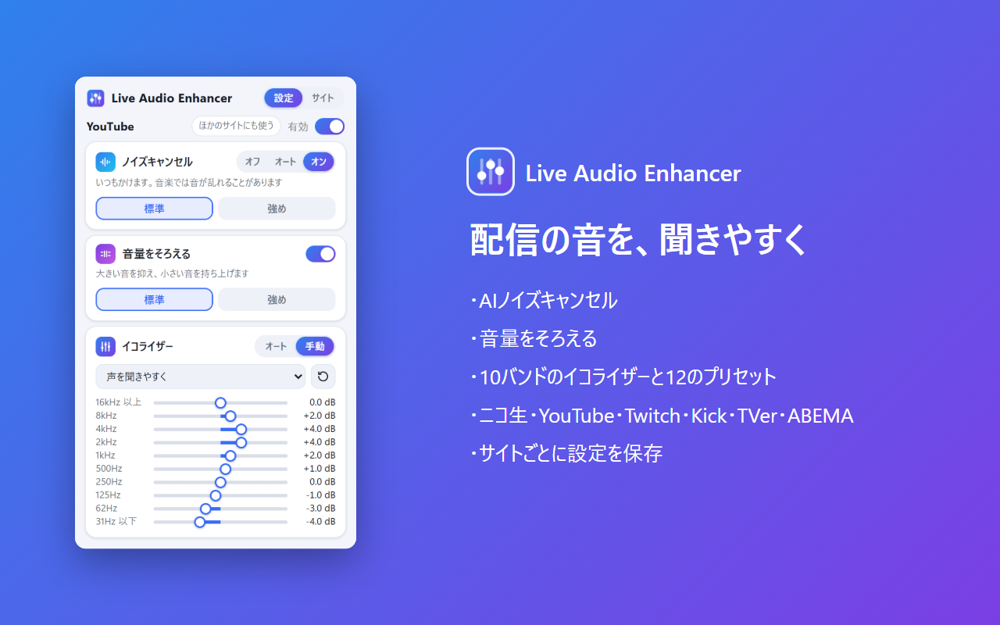

# Live Audio Enhancer

配信や動画の音を、その場で（リアルタイムに）聞きやすくするブラウザ拡張機能です。Chrome と Firefox に対応しています。



## 主な機能

- **AIノイズキャンセル**：声以外の雑音を抑えます。「標準」（RNNoise、軽い）と「強め」（DeepFilterNet3）から選べます。「オート」にすると、ふだんはかけ、音楽や歌が続くときは自動で外します
- **音量をそろえる**：大きすぎる音を抑え、小さい声を持ち上げます（標準・強め）
- **イコライザー**：10バンドと12種類のプリセット。「オート」にすると、番組の音を分析して、話し声が聞きやすいバランスに自動で整えます（音楽向けにしたいときは手動のプリセット）
- **音割れ防止**：音を持ち上げても音割れしないよう、リミッターが働きます
- **サイトごとの設定**：設定はサイトごとに保存します（ほかのサイトに同じ設定を使うこともできます）。「サイト」のタブで、サイトごとにオン・オフできます

## 対応サイト

ニコニコ生放送、YouTube、Twitch、Kick、TVer、ABEMA

各サイトの運営元とは関係のない、非公式の拡張機能です。

## インストール

- **Firefox**：Firefox Add-ons（AMO）で審査中です
- **Chrome**：Chrome ウェブストアへの提出を準備中です

開発中の版を読み込むときは、次のようにします。

- Chrome：`chrome://extensions` でデベロッパー モードをオンにし、「パッケージ化されていない拡張機能を読み込む」で `extension/` フォルダを選ぶ
- Firefox：`about:debugging` の「この Firefox」→「一時的なアドオンを読み込む」で `extension/manifest.json` を選ぶ（Firefox を再起動すると消える）

## プライバシー

音の処理は、すべてブラウザの中で行います。音声や閲覧履歴などのデータを集めたり、外部に送ったりすることはありません。保存するのは、拡張機能の設定だけです。

## 開発

拡張機能の本体（`extension/`）は、ビルドせずにそのまま動きます。`tools/` は、検証やストアに出すためのツールです（Node.js が要ります）。

```
npm install
```

| コマンド | 内容 |
|---|---|
| `npm run verify:<nico / kick / youtube / twitch / tver / abema>` | Chrome で対応サイトの配信を再生し、拡張の動作を自動で確かめる |
| `npm run verify:firefox -- <サイト>` | 同じことを Firefox で確かめる |
| `npm run pack:firefox` | Firefox のストアに出す ZIP を `dist/` に作る |
| `npm run release:firefox` | 新しい版を Firefox のストアに提出する（AMO の API キーが要る） |
| `npm run pack:chrome` | Chrome ウェブストアに出す ZIP を `dist/` に作る |
| `npm run amo:screenshots` / `npm run cws:images` | ストアに載せる画像を作る |
| `npm run vendor` | ノイズキャンセルのライブラリを `extension/vendor/` にコピーし直す |
| `npm run icons` | アイコンの PNG を SVG から作り直す |

設計や経緯の詳しい説明は [docs/handoff.md](docs/handoff.md) にあります。

## ライセンス

MIT License（[extension/LICENSE](extension/LICENSE)）

同梱のライブラリ（`extension/vendor/`）は、それぞれのライセンスに従います。ライセンス文は各フォルダにあります。

- RNNoise：[@sapphi-red/web-noise-suppressor](https://github.com/sapphi-red/web-noise-suppressor)（MIT）、[shiguredo/rnnoise-wasm](https://github.com/shiguredo/rnnoise-wasm)（Apache-2.0）、[xiph/rnnoise](https://github.com/xiph/rnnoise)（BSD-3-Clause）
- DeepFilterNet3：[@workadventure/noise-suppression](https://github.com/workadventure/noise-suppression)（MIT）、[DeepFilterNet](https://github.com/Rikorose/DeepFilterNet)（MIT / Apache-2.0）

---

## English

Live Audio Enhancer is a browser extension (Chrome / Firefox) that makes the sound of live streams and videos easier to listen to, in real time: AI noise suppression (RNNoise / DeepFilterNet3, with an Auto mode that turns it off while music or singing continues), volume leveling, a 10-band equalizer with presets and an Auto mode tuned for speech, and a limiter. Settings are saved per site, and each site can be turned on or off. It works on niconico Live, YouTube, Twitch, Kick, TVer and ABEMA. The user interface is in Japanese. All processing happens locally; no data is collected or sent. Licensed under the MIT License.
